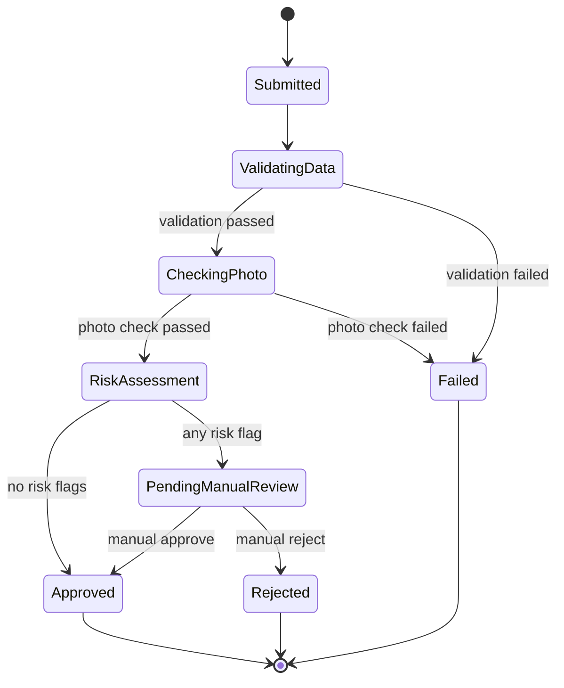

# Driving Licence Onboarding Workflow System — Requirements

> Source: *Senior .NET Developer Technical Assignment* (Scytales), 9 pages.
> This document restates the assignment as structured, referenceable requirements. Where the brief leaves a
> choice open, it is listed under [§7 Decisions to Document](#7-decisions-to-document) rather than decided here.

---

## Table of Contents

1. [Context & Goal](#1-context--goal)
2. [Solution Composition](#2-solution-composition)
3. [Functional Requirements](#3-functional-requirements)
4. [Reliability Requirements](#4-reliability-requirements)
5. [Optional Bonus Features](#5-optional-bonus-features)
6. [Deliverables & Constraints](#6-deliverables--constraints)
7. [Decisions to Document](#7-decisions-to-document)
8. [Evaluation](#8-evaluation)

---

## 1. Context & Goal

A citizen submits a driving licence application with **personal details** and a **face photo**. The backend:

1. stores the application,
2. starts an **asynchronous workflow**,
3. validates the data,
4. performs a **simulated** photo check and risk assessment,
5. ends in **Approved**, **Rejected**, **Failed**, or **PendingManualReview**.

The evaluators care about **approach, trade-offs and reasoning about backend systems** more than completeness.
AI tools, templates and libraries are explicitly allowed (their use must be disclosed — see [D-9](#7-decisions-to-document)).

---

## 2. Solution Composition

### 2.1 System Components

| ID | Component | Responsibility |
|---|---|---|
| SC-1 | **ASP.NET Core Web API** | Accepts submissions, exposes status/history, manual review endpoints. Persists the application and publishes the processing message. |
| SC-2 | **Database persistence** | Stores applications, photo (or reference), workflow state, audit trail. |
| SC-3 | **Queue** | Carries `ApplicationSubmitted` (and any further) messages between API and worker. |
| SC-4 | **Background worker** | Consumes queue messages and executes the workflow steps. |
| SC-5 | **Workflow / state machine** | Defines the states and the allowed transitions; rejects invalid ones. |
| SC-6 | **Audit trail** | Records every important state transition, including manual actions. |
| SC-7 | **Automated tests** | Cover the important business logic. |
| SC-8 | **Docker Compose setup** | Runs the whole system locally. |
| SC-9 | **README** | How to run + key design decisions. |

### 2.2 Technical Stack

| ID | Requirement | Notes |
|---|---|---|
| TR-1 | **.NET 8 or newer** | |
| TR-2 | **ASP.NET Core Web API** | |
| TR-3 | **Background worker service** | Separate process from the API. |
| TR-4 | **PostgreSQL** *or another documented database* | |
| TR-5 | **RabbitMQ** *or another documented queue* | |
| TR-6 | **Docker Compose** | |
| TR-7 | **Swagger / OpenAPI** | |
| TR-8 | **Structured logging** | |
| TR-9 | **Automated tests for important business logic** | |

### 2.3 Runtime Topology

The project must start locally with a single command:

```bash
docker compose up
```

Docker Compose must start **at minimum** these services:

| Service | Maps to |
|---|---|
| `api` | SC-1 |
| `worker` | SC-4 |
| `database` | SC-2 |
| `queue` | SC-3 |

### 2.4 End-to-End Processing Flow

```
 Client ──POST──▶ api ──(1) store application + initial state──▶ database
                   │
                   └──(2) publish ApplicationSubmitted──▶ queue ──▶ worker
                                                                     │
                       (3) execute workflow steps ◀──────────────────┘
                       (4) update application status ──▶ database
                       (5) record workflow history   ──▶ database
```

1. API receives the application.
2. API stores the application in the database.
3. API publishes an `ApplicationSubmitted` message.
4. Worker consumes the message.
5. Worker executes workflow steps.
6. Application status is updated.
7. Workflow history is recorded.

> **Constraint:** processing must **not** happen entirely inside the HTTP request.

---

## 3. Functional Requirements

### FR-1 — Submit Application

`POST /api/applications`

**Request — personal details:**

| Field | Example | Notes |
|---|---|---|
| `firstName` | `"John"` | |
| `lastName` | `"Doe"` | |
| `dateOfBirth` | `"1990-05-20"` | Used for the 18+ and <21 rules. |
| `nationalId` | `"AB123456"` | Required; checked against the watchlist. |
| `email` | `"john.doe@example.com"` | Must be valid. |
| `phoneNumber` | `"+306900000000"` | |
| `address` | `"Example Street 10"` | |
| `licenceCategory` | `"B"` | Non-`B` triggers manual review. |

**Request — face photo:** must be included. Transport is our choice (see [D-1](#7-decisions-to-document)):
multipart file upload · base64 payload · separate upload endpoint · simulated file reference.

**Expected behaviour:**

| ID | Behaviour |
|---|---|
| FR-1.1 | Store the application. |
| FR-1.2 | Store (or simulate storing) the photo. |
| FR-1.3 | Create the initial workflow state (`Submitted`). |
| FR-1.4 | Publish a message to a queue for asynchronous processing. |
| FR-1.5 | Return the application ID and initial status. |

**Response:**

```json
{
  "applicationId": "8c04d6e7-8e51-4b95-84e2-efc8a8ec4a5a",
  "status": "Submitted"
}
```

---

### FR-2 — Get Application Status

`GET /api/applications/{applicationId}`

| ID | Behaviour |
|---|---|
| FR-2.1 | Return the current status of the application with creation and last-update timestamps. |

**Response:**

```json
{
  "applicationId": "8c04d6e7-8e51-4b95-84e2-efc8a8ec4a5a",
  "status": "PendingManualReview",
  "createdAt": "2026-06-09T10:30:00Z",
  "updatedAt": "2026-06-09T10:35:00Z"
}
```

---

### FR-3 — Workflow Processing

The application moves through a backend workflow. Implementation technology is our choice (see [D-2](#7-decisions-to-document)).

**FR-3.1 — Minimum required states**

| State | Kind |
|---|---|
| `Submitted` | Initial |
| `ValidatingData` | Processing |
| `CheckingPhoto` | Processing |
| `RiskAssessment` | Processing |
| `PendingManualReview` | Waiting (human) |
| `Approved` | Terminal |
| `Rejected` | Terminal |
| `Failed` | Terminal |

**FR-3.2 — Reference flows**

```
Automatic approval         Manual review                 Failure
──────────────────         ─────────────                 ───────
Submitted                  Submitted                     Submitted
 -> ValidatingData          -> ValidatingData             -> ValidatingData
 -> CheckingPhoto           -> CheckingPhoto              -> Failed
 -> RiskAssessment          -> RiskAssessment
 -> Approved                -> PendingManualReview
                            -> Approved / Rejected
```

**FR-3.3 — Transition diagram (derived from the flows and rules above)**



> The brief shows only `ValidatingData -> Failed` explicitly; `CheckingPhoto -> Failed` is inferred from FR-5.2
> ("photo check should **fail**"). Treat this as an assumption to note in the README.

| ID | Rule |
|---|---|
| FR-3.4 | Only defined transitions are allowed; invalid transitions must be prevented. |

---

### FR-4 — Asynchronous Processing

| ID | Requirement |
|---|---|
| FR-4.1 | Processing must not happen entirely inside the HTTP request. |
| FR-4.2 | Use a **queue** and a **background worker** (see [§2.4](#24-end-to-end-processing-flow)). |
| FR-4.3 | The API publishes an `ApplicationSubmitted` message after persisting the application. |
| FR-4.4 | The worker consumes the message, executes the workflow, updates status, records history. |

Suggested options (see [D-3](#7-decisions-to-document)): RabbitMQ · MassTransit · Azure Service Bus abstraction ·
Kafka · PostgreSQL-backed queue · another documented approach.

---

### FR-5 — Simulated Business Rules

No real biometric, identity or government integration — all checks are **simulated**.

**FR-5.1 — Data validation → `Failed` if any:**

| ID | Rule |
|---|---|
| FR-5.1.1 | Required fields are missing. |
| FR-5.1.2 | Email is invalid. |
| FR-5.1.3 | National ID is missing. |
| FR-5.1.4 | Applicant is under 18. |

**FR-5.2 — Photo check → `Failed` if any:**

| ID | Rule |
|---|---|
| FR-5.2.1 | No photo was provided. |
| FR-5.2.2 | File type is unsupported. |
| FR-5.2.3 | File size is too small. |
| FR-5.2.4 | Simulated photo quality score is too low. |

**FR-5.3 — Risk assessment → `PendingManualReview` if any:**

| ID | Rule | Configurable |
|---|---|---|
| FR-5.3.1 | Applicant is below 21. | |
| FR-5.3.2 | Licence category is not `B`. | |
| FR-5.3.3 | National ID exists in a watchlist. | ✅ watchlist |
| FR-5.3.4 | Photo quality score is below a threshold. | ✅ threshold |

| ID | Rule |
|---|---|
| FR-5.4 | If no risk rule fires, the application may be **automatically approved**. |

> Note: there are two photo-quality thresholds — a hard **fail** floor (FR-5.2.4) and a configurable
> **manual-review** threshold (FR-5.3.4). The latter must sit above the former.

---

### FR-6 — Manual Review

| Endpoint | Purpose |
|---|---|
| `POST /api/applications/{applicationId}/approve` | Approve an application under review. |
| `POST /api/applications/{applicationId}/reject` | Reject an application under review. |

Reject may accept a reason:

```json
{ "reason": "Photo does not meet quality requirements" }
```

| ID | Rule |
|---|---|
| FR-6.1 | Only applications in `PendingManualReview` can be manually approved or rejected. |
| FR-6.2 | Invalid state transitions return a **proper error**. |
| FR-6.3 | Manual actions are recorded in the audit trail. |

---

### FR-7 — Audit Trail

`GET /api/applications/{applicationId}/history`

| ID | Rule |
|---|---|
| FR-7.1 | Every important state transition is stored. |
| FR-7.2 | Each entry carries `timestamp`, `fromStatus` (nullable for creation), `toStatus`, `event`, and optional `details`. |
| FR-7.3 | The endpoint returns the history of the given application. |

**Response:**

```json
[
  { "timestamp": "2026-06-09T10:30:00Z", "fromStatus": null,             "toStatus": "Submitted",           "event": "ApplicationCreated" },
  { "timestamp": "2026-06-09T10:31:00Z", "fromStatus": "Submitted",      "toStatus": "ValidatingData",      "event": "ValidationStarted" },
  { "timestamp": "2026-06-09T10:32:00Z", "fromStatus": "ValidatingData", "toStatus": "CheckingPhoto",       "event": "ValidationPassed" },
  { "timestamp": "2026-06-09T10:34:00Z", "fromStatus": "RiskAssessment", "toStatus": "PendingManualReview", "event": "ManualReviewRequired", "details": "Applicant is below 21" }
]
```

**Event names shown in the brief:** `ApplicationCreated`, `ValidationStarted`, `ValidationPassed`,
`ManualReviewRequired`. The remaining event names (photo check, risk, approval, rejection, failure, manual actions)
are ours to define consistently.

---

## 4. Reliability Requirements

Not expected to be production-ready, but production failure modes must be **considered and documented**
(implemented fully, or the intended approach explained if time is limited).

| ID | Question to answer |
|---|---|
| RL-1 | What happens if the **same message is processed twice**? |
| RL-2 | What happens if the API **saves the application but fails to publish** the message? |
| RL-3 | What happens if the **worker crashes during processing**? |
| RL-4 | How are **invalid workflow transitions prevented**? |
| RL-5 | How are **failures recorded**? |
| RL-6 | How would **retries or dead-letter handling** work? |
| RL-7 | What would you **improve before production**? |

---

## 5. Optional Bonus Features

Add only where they improve the solution.

| ID | Feature | Addresses |
|---|---|---|
| BN-1 | Outbox pattern | RL-2 |
| BN-2 | Idempotency key for application submission | duplicate submissions |
| BN-3 | Retry policy with exponential backoff | RL-6 |
| BN-4 | Dead-letter queue | RL-6 |
| BN-5 | OpenTelemetry tracing | observability |
| BN-6 | Health checks | ops / compose readiness |
| BN-7 | Integration tests with Testcontainers | testing |
| BN-8 | Configurable workflow definition loaded from JSON | workflow |
| BN-9 | Simple authentication/authorization for manual review endpoints | FR-6 |

---

## 6. Deliverables & Constraints

### 6.1 Deliverables

| ID | Deliverable |
|---|---|
| DL-1 | Source code repository. |
| DL-2 | README with setup instructions. |
| DL-3 | Short architecture explanation. |
| DL-4 | Docker Compose setup. |
| DL-5 | Basic tests. |
| DL-6 | Notes about assumptions, shortcuts, **AI usage**, and production improvements. |

### 6.2 Constraints

- **Time box: 6–8 hours.**
- Incomplete parts must be documented: what is missing and what would come next.
- Engineering judgement, trade-off awareness and clear communication are valued over feature count.

---

## 7. Decisions to Document

Choices the brief explicitly leaves open and asks us to justify in the README.

| ID | Decision | Options given | Related |
|---|---|---|---|
| D-1 | Photo handling | multipart upload · base64 · separate upload endpoint · simulated file reference | FR-1, FR-5.2 |
| D-2 | Workflow engine | custom state machine · MassTransit state machine · Elsa · Temporal · Durable Task Framework · other | FR-3 |
| D-3 | Queue / messaging | RabbitMQ · MassTransit · Azure Service Bus abstraction · Kafka · PostgreSQL-backed queue · other | FR-4 |
| D-4 | Database | PostgreSQL or another documented DB | TR-4 |
| D-5 | Simulated photo quality score | how it is produced (deterministic vs random) | FR-5.2.4, FR-5.3.4 |
| D-6 | Configuration of watchlist & thresholds | source and format | FR-5.3.3, FR-5.3.4 |
| D-7 | Error contract for invalid transitions | status code & body shape | FR-6.2 |
| D-8 | Reliability approach | answers to RL-1 … RL-7 | §4 |
| D-9 | AI usage disclosure | which parts were generated/assisted | DL-6 |

---

## 8. Evaluation

### 8.1 Weighting

| Area | Weight |
|---|---:|
| Working functionality | 20% |
| Architecture and maintainability | 20% |
| Workflow / state-machine design | 15% |
| Queue and async processing | 15% |
| Reliability and failure handling | 10% |
| Testing | 10% |
| Docker / local developer experience | 5% |
| README and communication | 5% |

### 8.2 Review Discussion — be ready to explain

- Why this architecture was chosen.
- How the workflow / state machine works.
- How invalid state transitions are prevented.
- How queue messages are processed.
- Whether consumers are idempotent.
- What happens on duplicate messages.
- What happens if services crash.
- Which parts were generated or assisted by AI.
- What would be improved for production.
